# fitsky-patterns

The screens of [fitsky](https://github.com/thats-it-dev/fitsky-app)'s Pebble
app, rebuilt as pebble-ui windows with sample data. Fitsky took its UI from
the old Pebble examples; this is where those screens became library
components. Emery (Pebble Time 2) and gabbro (Pebble Round 2).

| Pattern | Component | Emery | Gabbro |
| --- | --- | --- | --- |
| Workout type cards | `CardMenu` |  | 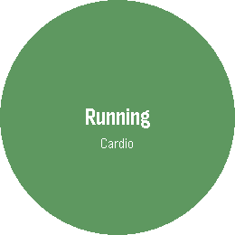 |
| Start menu | `ActionMenu` | 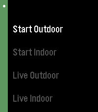 | 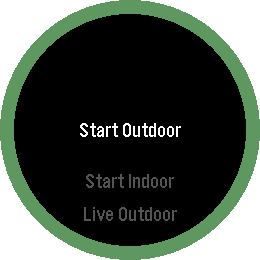 |
| Finish menu | `ActionMenu` |  |  |
| Workout dashboard | `StatsScreen` | 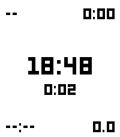 | 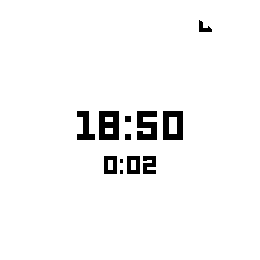 |
| Exercise dashboard | `StatsScreen` with a title | 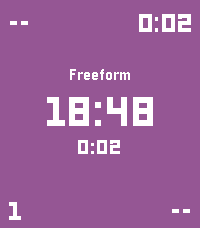 | 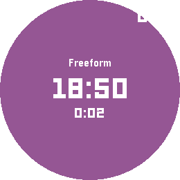 |
| Sets, reps and weight | `AdjustWindow` | 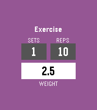 | 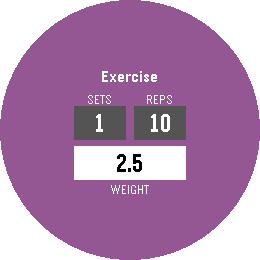 |
| Heart rate zones | `BarList` | 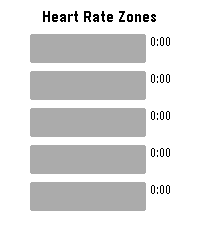 | 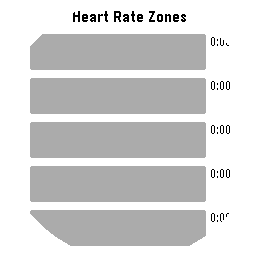 |
| Workout summary | `InfoScreen` |  |  |
| Interval round | `InfoScreen` | 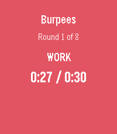 | 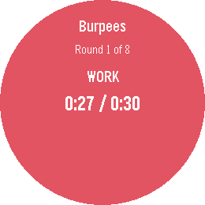 |
| Plans | `SubtitleMenu` | 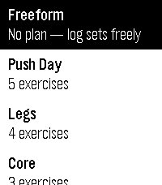 | 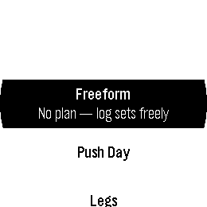 |

## Verified against the C app

Fitsky's C app was built for emery and gabbro, driven through its screens in
the emulators and screenshotted, and these windows were put through the same
steps with the same values. Every screen above is pixel-identical to the C
app's on emery (the dashboards' clocks excepted: they show the time). On
gabbro the same holds, except for an anti-aliased band along the top of the
action menu's ring, which the firmware draws and this does not (248 pixels).
The plans menu's reference came from a small C probe, since the emulator has
no fitsky plans to show; the interval screen has no C reference (fitsky no
longer reaches it) and follows its source.

Fitsky's heart rate zone labels do not appear in the C app (it hands a stack
buffer to a TextLayer), so the sample data here leaves them empty to match;
`BarList` draws labels when given them.

## Running

```sh
pebble build
pebble install --emulator emery     # or gabbro
```

The home menu lists the patterns; each opens with Select and closes with Back.
The adjust window's Select moves from sets and reps to the weight, Back goes
up a row, and completing the weight logs the values. The action menus log the
chosen action after they close.

## Memory

`stack 5120, slot 45056, chunk 21504` (`src/c/mdbl.c`), Piu lists 1024. The
windows are opened by module name so each library module loads when first
used; opening them all leaves little slot heap, and the compiled JavaScript
(41 kB) shares the emulator's app heap with the machine. See the library
README.
